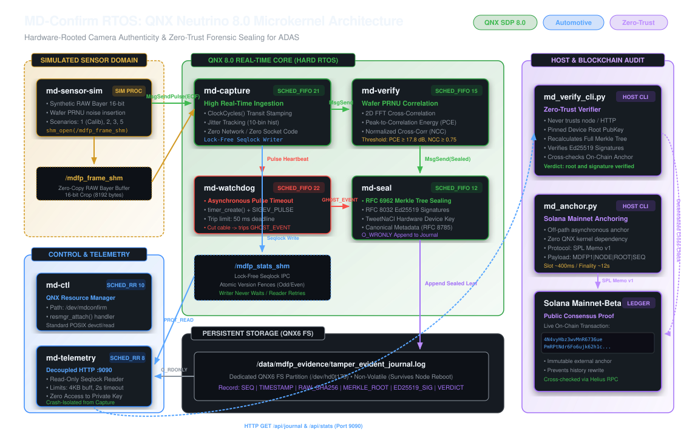
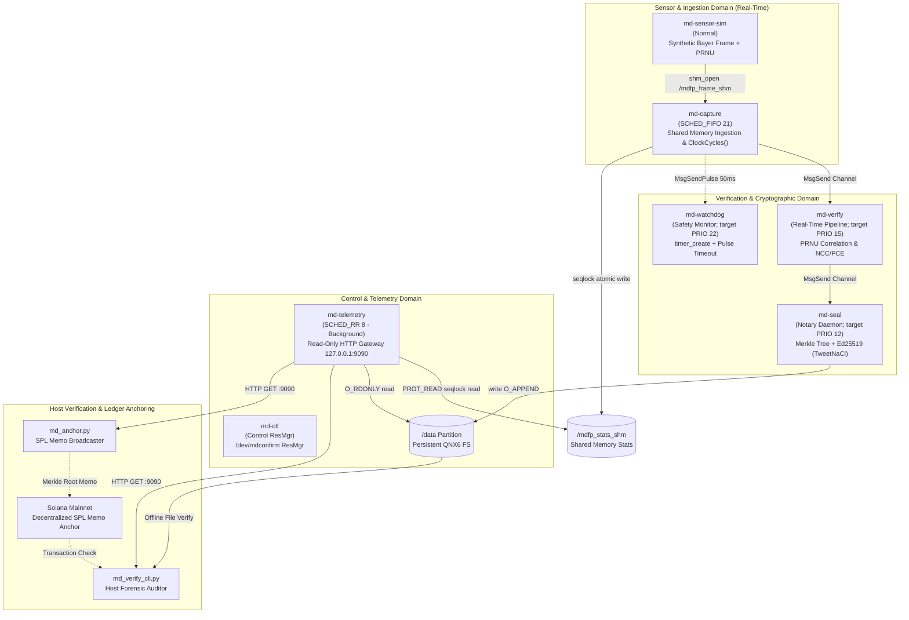

Built for the QNX Global Hackathon. Not affiliated with BlackBerry or QNX.

# Sensor-Bound Camera Attestation and Tamper-Evident Event Log for Vehicles on QNX 8.0

**Hackathon Entry:** BlackBerry QNX Global Hackathon 2026  
**Author:** miracledropletmd  
**Primary Track:** Automotive & Mobility (ADAS Black Box & Crash Evidence Sealing)  
**Target Special Prize:** Best Use of QNX-specific Technologies ($3,500)  

---

## Quick Start

```bash
# 1. Build QNX binaries (requires BlackBerry QNX SDP 8.0)
cd qnx && make all && cd ..

# 2. Run scenario evaluations under QEMU
./run_all_scenarios.sh

# 3. Verify evidence journal independently against Solana Mainnet
python3 host/verify-cli/md_verify_cli.py --source /data/mdfp_evidence/tamper_evident_journal.log --solana-tx 4N4vyHbz3wvMnR6736uePmRPtNdr6Fo6ujk62h1cPhF9tdoUUAicZX7oGwZD4AdRLdkKMC8nD1eEn7Kgb46SPiZW
```

> **Trust Boundary, Known Limitations & Verification Scope:** See [`docs/TRUST_BOUNDARY.md`](docs/TRUST_BOUNDARY.md) (what is inside vs. outside the boundary, who can forge shm frames, and what Ed25519 signatures prove) and [`docs/LIMITATIONS.md`](docs/LIMITATIONS.md) (simulation vs. measurement labels and host-only CI policy).  
> **Direct Evidence Logs & Artifacts:** Full execution outputs (`uname -a`, `pidin`, scenario runs, and before/after telemetry jitter histograms) are available in [`docs/evidence/`](docs/evidence/).

---

## 1. Project Overview

**MD-Confirm RTOS** is a modular microkernel security framework built for **BlackBerry QNX Neutrino RTOS 8.0**. When a RAW frame is ingested, the system copies it once from shared memory into a private buffer (`PrivateFrameSnapshot`), hashes it over that private copy (`frame_sha256`), checks its sensor fingerprint (PRNU) statistically, records timing via `ClockCycles()`, signs Merkle commitments with Ed25519 over canonical JSON event metadata, and optionally anchors the Merkle root to Solana.

* **What we prove (`SIMULATED` / Software Demo):** The Ed25519 signature proves **"this node (`md-seal`) accepted these bytes (`frame_sha256` + canonical metadata) at this time"**, and pixel attribution statistically matches a reference sensor pattern (PRNU). In this demo frames are synthetic and arrive via `/mdfp_frame_shm`; there is no real DMA or MIPI CSI-2 hardware (see [`docs/TRUST_BOUNDARY.md`](docs/TRUST_BOUNDARY.md) and [`docs/LIMITATIONS.md`](docs/LIMITATIONS.md)).
* **What we do NOT prove:** That `/mdfp_frame_shm` writers are uncompromised before `md-capture` copies a frame (whoever can write `/mdfp_frame_shm` can forge frames), hardware-protected private keys (software `FileSigner` only), or that the physical scene in front of the lens is authentic.

---

## 2. Boundaries of Applicability & Threat Model

In mission-critical embedded systems and forensic computing, acknowledging threat limits and boundaries is essential:

* **Sensor-to-Memory Scope:** The system checks whether a frame statistically matches a reference PRNU pattern and records cryptographic journal commitments. It does **not** authenticate physical scene reality (e.g. optical playback or projectors in front of the lens require active depth sensing).
* **Simulation in QEMU x86_64 (`SIMULATED`):** All QNX test scenarios and pipeline benchmarks are demonstrated on **SYNTHETIC frames** inside QEMU x86_64 running QNX SDP 8.0. Virtualized latency and jitter measurements do not substitute for bare-metal hardware validation (`NOT YET MEASURED`).
* **Scenario 4 (Synthetic Injection with Pre-applied Noise — `ROADMAP`):** Frame-rhythm / jitter blocking for frames carrying pre-applied $K_{\text{REF}}$ noise is not yet enforced in `md-verify` (`allow = true` currently logs the scenario as flagged; real camera timing ROC is `NOT YET MEASURED`).
* **Key Protection Model (No Hardware Key Protection):** `md-seal` uses [`qnx/common/mdfp_signer.h`](qnx/common/mdfp_signer.h) (`FileSigner` software TweetNaCl key stored on filesystem; refuses group- or world-readable key files where POSIX `mode & 0077 != 0`, auto-provisioning the demo key at `0600` when the default path does not yet exist). **There is no hardware key protection today** (`HardwareTokenSignerStub` for PKCS#11 / TPM 2.0 / Secure Element is an unimplemented `ROADMAP` stub, and `swtpm` is strictly software emulation). See [`docs/TRUST_BOUNDARY.md`](docs/TRUST_BOUNDARY.md).
* **Journal Property:** The forensic evidence journal is **tamper-evident**, not physically immutable WORM media; physical write-protection relies on the underlying storage controller. **Modification, rollback, and tail-truncation detection hold strictly relative to an external checkpoint** (`--checkpoint STH_FILE`, `--solana-tx`, or `--tsa-tsr` + `--tsa-ca`; without one, tail truncation or full-log rollback cannot be detected). See [`docs/LIMITATIONS.md`](docs/LIMITATIONS.md) for current boundaries.

| # | Threat Scenario | PRNU only | PRNU + extra signals | Technical Mechanism & Rationale |
|---|-----------------|-----------|----------------------|----------------------------------|
| 1 | Frame from another physical camera (Silicon swap) | **YES** (`SIMULATED`) | **YES** (`SIMULATED`) | Low Peak-to-Correlation Energy ($\text{PCE} < 60.0$ linear / $< 17.78\text{ dB}$) relative to synthetic $K_{\text{REF}}$ |
| 2 | Synthetic AI deepfake (no silicon noise) | **YES** (`SIMULATED`) | **YES** (`SIMULATED`) | Flat synthetic frame yields negligible PRNU correlation ($\text{PCE} \ll 17.78\text{ dB}$, $\text{NCC} \approx 0.01$) |
| 3 | Frame alteration after ingestion copy | **YES (IPC boundary)** (`SIMULATED`, QNX 8.0 QEMU verified) | **YES (IPC boundary)** (`SIMULATED`, QNX 8.0 QEMU verified) | `md-capture` copies `/mdfp_frame_shm` once into `PrivateFrameSnapshot` and hashes before IPC; `md-verify` makes zero SHM reads and re-checks `SHA-256 == frame_sha256` (`BLOCK_INGEST_HASH_MISMATCH`). Writes to `/mdfp_frame_shm` *before* copy remain outside the boundary ([`docs/TRUST_BOUNDARY.md`](docs/TRUST_BOUNDARY.md)) |
| 4 | Synthetic frame with pre-applied $K_{\text{REF}}$ noise (fingerprint-copy attack) | **NO / ROADMAP** | **YES** (`SIMULATED`, `--extra-signals` off by default) | PRNU passes by construction (real-dataset $N_{\text{attack}}$ is `NOT YET MEASURED` in [`host/prnu-eval/`](host/prnu-eval/)). With optional `--extra-signals`, synthetic $K_{\text{REF}}$ without valid `HMAC(secret, frame_seq)` exposure modulation fails (`BLOCK_CHALLENGE_MODULATION`). Note: shared-secret sim demonstrates logic only; real per-frame sensor control is unverified |
| 5 | Optical playback in front of lens (screen attack) | **BOUNDARY** | **BOUNDARY** (partial `SIMULATED` CAN check on host) | Outside silicon sensor perimeter (requires active optical depth sensing); host-only `SIMULATED` optical-flow vs CAN speed check ([`host/can-flow/`](host/can-flow/)) only flags motion mismatch |
| 6 | Hardware bus emulator on FPGA with precise rhythm | **BOUNDARY** | **BOUNDARY** (`BOUNDARY` without HW sensor secret) | Physical CSI-2 bus timing can be mimicked by custom FPGA hardware; software shared-secret challenge-response in sim does not protect against key compromise |
| 7 | MIPI cable severed or camera power loss | **YES** (`SIMULATED`) | **YES** (`SIMULATED`) | `md-watchdog`: Asynchronous QNX pulse timeout ($> 50\text{ ms}$) trips emergency `GHOST_EVENT` |
| 8 | Tampering with stored records after capture | **YES relative to external checkpoint** (`SIMULATED`, QNX + host verified) | **YES relative to external checkpoint** (`SIMULATED`, QNX + host verified) | Detects modified metadata (`CANON` + `LEAF`), duplicated leaves, reordered/swapped records, invalid Ed25519 signatures, broken `prev_sth_sha256` STH chains, and rollback/tail truncation **relative to an external checkpoint** (trusted STH file, Solana memo, or RFC 3161 TSA) via strict RFC 6962 inclusion & consistency proofs. Without an external checkpoint, tail truncation is not detectable (`WARNING` emitted) |
| 9 | Root exploit on node / private key extraction | **BOUNDARY** | **BOUNDARY** | `FileSigner` uses filesystem keys with no hardware key protection (`swtpm` is emulation only; PKCS#11 / hardware TPM 2.0 / Secure Element = `ROADMAP`) |
| 10 | Replay of previously recorded authentic frames (same $K_{\text{REF}}$) | **NO** | **YES** (`SIMULATED`, `--extra-signals` off by default) | Recorded authentic frames carry valid $K_{\text{REF}}$ so PRNU alone passes them. With `--extra-signals` (`qnx/common/mdfp_signals.h`, compiled & run under QNX 8.0 QEMU in [`docs/evidence/qnx_8_qemu/`](docs/evidence/qnx_8_qemu/)), verbatim replays fail `BLOCK_SEQ_REPLAY`, counter skips/timing faults fail `BLOCK_SEQ_GAP` / `BLOCK_TIMING_OUT_OF_BOUNDS`, and re-stamped frames fail `BLOCK_CHALLENGE_MODULATION`; offline [`host/can-flow/`](host/can-flow/) flags motion vs CAN speed mismatches (`SIMULATED`) |

---

## 3. Native QNX 8.0 Microkernel Architecture



MD-Confirm RTOS leverages QNX Neutrino's microkernel process isolation, splitting responsibilities into isolated processes communicating via POSIX shared memory and QNX native IPC:



### Safety Decoupling (Real-Time vs Network Serving):
* **Real-Time Ingestion Process (`md-capture`):** Runs at high real-time priority (`SCHED_FIFO 21`). It contains **zero** network sockets or client threads so network I/O is isolated to `md-telemetry`.
* **Lock-Free Seqlock IPC (`/mdfp_stats_shm`):** `md-capture` publishes telemetry and jitter metrics via [`qnx/common/mdfp_seqlock.h`](qnx/common/mdfp_seqlock.h) using C++17 `std::atomic` sequence versioning (`memory_order_acquire`/`release`) and atomic payload words with fences (odd = write in progress; even = stable snapshot). **`md-capture` never waits on telemetry readers (seqlock)**, takes mutexes, or yields to background HTTP requests (note: on the capture pipeline itself, `md-capture` still calls blocking `MsgSend()` to `md-verify`).
* **Low-Priority Read-Only Telemetry (`md-telemetry`):** Runs at background priority `SCHED_RR 8` (`MDFP_PRIO_TELEMETRY`), listening on `127.0.0.1:9090` by default (`--bind` to change).
  * **Memory Isolation:** Maps `/mdfp_stats_shm` strictly read-only (`PROT_READ`). Readers retry on concurrent writes.
  * **Journal Isolation:** Opens `/data/mdfp_evidence/tamper_evident_journal.log` strictly `O_RDONLY` (configurable via `--journal`).
  * **Key Zero-Exposure:** `md-telemetry` has zero access to the device private key `g_device_sk` (held inside `md-seal`).
  * **Network Hardening:** Standalone request-line parser ([`qnx/common/mdfp_http.h`](qnx/common/mdfp_http.h)) strictly parses HTTP/1.x **GET** requests for exact routes (`/api/journal`, `/journal`, `/api/stats`, `/status`, `/api/health`); returns `400 Bad Request`, `414 URI Too Long`, `405 Method Not Allowed`, or `404 Not Found`. Socket limits: 4 KB request buffer, 2-second `SO_RCVTIMEO`/`SO_SNDTIMEO`, backlog 8, `Connection: close`.
  * **Crash Immunity:** If `md-telemetry` crashes or is killed via `slay`, `md-capture` keeps running; before/after `slay` output and QEMU jitter histograms with and without telemetry load are in [`docs/evidence/`](docs/evidence/) (`SIMULATED` in QEMU, not bare metal).

---

## 4. Evidence of QNX-specific Technologies Use

| QNX Technology / Native API | Source File & Permalink | Concrete Architectural Purpose |
|-----------------------------|-------------------------|--------------------------------|
| `resmgr_attach()` | [`qnx/ctl/md-ctl.cpp#L115`](https://github.com/CenterDigitalTrust/MD-Confirm-RTOS/blob/8da9c5bd0c1a03d509cb047a0e5b17f17dab8315/qnx/ctl/md-ctl.cpp#L115) | Registers QNX Resource Manager at `/dev/mdconfirm` to expose control interfaces via standard POSIX `read()`/`write()` |
| `MsgSendPulse()` | [`qnx/sensor-sim/md-sensor-sim.cpp#L138`](https://github.com/CenterDigitalTrust/MD-Confirm-RTOS/blob/8da9c5bd0c1a03d509cb047a0e5b17f17dab8315/qnx/sensor-sim/md-sensor-sim.cpp#L138) | Non-blocking asynchronous simulated interrupt pulse delivery (EOF IRQ) into `md-capture` |
| `ClockCycles()` | [`qnx/capture/md-capture.cpp#L94`](https://github.com/CenterDigitalTrust/MD-Confirm-RTOS/blob/8da9c5bd0c1a03d509cb047a0e5b17f17dab8315/qnx/capture/md-capture.cpp#L94) | High-resolution hardware cycle counter for ingestion wakeup latency and jitter timestamping |
| `timer_create()` + `SIGEV_PULSE` | [`qnx/watchdog/md-watchdog.cpp#L55`](https://github.com/CenterDigitalTrust/MD-Confirm-RTOS/blob/8da9c5bd0c1a03d509cb047a0e5b17f17dab8315/qnx/watchdog/md-watchdog.cpp#L55) | Real-time periodic kernel timer watchdog; trips emergency `GHOST_EVENT` if frame arrival exceeds 50 ms deadline |
| `shm_open()` + `mmap()` (Frame SHM) | [`qnx/sensor-sim/md-sensor-sim.cpp#L48`](https://github.com/CenterDigitalTrust/MD-Confirm-RTOS/blob/8da9c5bd0c1a03d509cb047a0e5b17f17dab8315/qnx/sensor-sim/md-sensor-sim.cpp#L48) | Shared memory buffer (`/mdfp_frame_shm`) for synthetic 16-bit RAW Bayer frame delivery |
| `shm_open()` + `mmap()` (Seqlock) | [`qnx/capture/md-capture.cpp#L56`](https://github.com/CenterDigitalTrust/MD-Confirm-RTOS/blob/8da9c5bd0c1a03d509cb047a0e5b17f17dab8315/qnx/capture/md-capture.cpp#L56) | Lock-free atomic stats publication (`/mdfp_stats_shm`) mapped strictly `PROT_READ` by `md-telemetry` |
| `MsgReceive()` / `MsgSend()` | [`qnx/verify/md-verify.cpp#L82`](https://github.com/CenterDigitalTrust/MD-Confirm-RTOS/blob/8da9c5bd0c1a03d509cb047a0e5b17f17dab8315/qnx/verify/md-verify.cpp#L82) | Synchronous IPC pipeline channels across `md-capture` → `md-verify` → `md-seal` |

---

## 5. Why QNX

1. **Process Isolation & Memory Fault Resilience:** Each security service runs in its own MMU-isolated QNX process, and `md-telemetry` maps `/mdfp_stats_shm` strictly read-only (`PROT_READ`). If the low-priority HTTP gateway `md-telemetry` crashes or is killed via `slay`, `md-capture` and `md-seal` continue operating without memory corruption — observed directly in [`docs/evidence/pidin.txt`](docs/evidence/pidin.txt) (`PIDIN BEFORE SLAY` / `PIDIN AFTER SLAY`), [`docs/evidence/jitter_baseline.json`](docs/evidence/jitter_baseline.json), [`docs/evidence/jitter_under_100_curls.json`](docs/evidence/jitter_under_100_curls.json), and [`qnx/telemetry/md-telemetry.cpp`](qnx/telemetry/md-telemetry.cpp).
2. **Priority Preemptive Scheduling:** `md-capture` executes under `SCHED_FIFO 21` while `md-telemetry` runs at background priority `SCHED_RR 8` (additional target daemon priorities are defined in [`qnx/common/mdfp_protocol.h`](qnx/common/mdfp_protocol.h)), preventing HTTP traffic from preempting capture execution (QEMU virtualized jitter measurements in [`docs/evidence/`](docs/evidence/) show millisecond-scale VM scheduling variance; bare-metal latency is `NOT YET MEASURED`).
3. **Native Message Passing (`MsgSend` / `MsgReceive`):** Pipeline stages (`md-capture` → `md-verify` → `md-seal` and `md-watchdog` → `md-seal`) communicate directly over QNX channels (`name_attach()` / `MsgSend()` / `MsgReceive()`) without local TCP/IP socket serialization (`qnx/verify/md-verify.cpp`, `qnx/capture/md-capture.cpp`; message passing performs kernel IPC transitions and context switches). Additionally, `md-ctl` uses the QNX Resource Manager framework (`resmgr_attach()`) for `/dev/mdconfirm`.
4. **Kernel Timer Pulses (`timer_create` & `SIGEV_PULSE`):** `md-watchdog` uses QNX asynchronous kernel timer pulses (`timer_create(CLOCK_MONOTONIC)`) to trigger emergency `GHOST_EVENT` sealing if frame heartbeats lapse for $> 50\text{ ms}$ ([`qnx/watchdog/md-watchdog.cpp`](qnx/watchdog/md-watchdog.cpp)).

---

## 6. Known Limitations (Summary)

Full details live in **[`docs/LIMITATIONS.md`](docs/LIMITATIONS.md)**. Key constraints include:

1. **Synthetic Frames:** `md-sensor-sim` generates synthetic frames in shared memory (`/mdfp_frame_shm`, mode `0666`); whoever can write `/mdfp_frame_shm` can forge frames ([`docs/TRUST_BOUNDARY.md`](docs/TRUST_BOUNDARY.md)). There is no real DMA or MIPI CSI-2 sensor hardware.
2. **QEMU Virtualization:** All QNX timing logs (`docs/evidence/`) were collected inside QEMU x86_64 virtualization; bare-metal determinism is `NOT YET MEASURED`.
3. **Software Key Files (No Hardware Key Protection):** `md-seal` uses [`qnx/common/mdfp_signer.h`](qnx/common/mdfp_signer.h) (`FileSigner` with strict POSIX `0600` key permission checks; no hardware key protection; [`HardwareTokenSignerStub`](qnx/common/mdfp_signer.h) is unimplemented `ROADMAP`, and `swtpm` is strictly software emulation). `K_REF` remains deterministically simulated in code.
4. **Synchronous Pipeline & Ingestion Boundary:** `md-capture` → `md-verify` → `md-seal` runs synchronous `MsgSend()` calls, while `md-capture` now takes a single-pass `PrivateFrameSnapshot` + `frame_sha256` before IPC and `md-verify` never re-reads SHM (`mdfp_ingest.h` host-tested; QNX IPC compiled cleanly with QNX SDP 8.0 and exercised in [`docs/evidence/qnx_8_qemu/`](docs/evidence/qnx_8_qemu/)).
5. **Persistent `/data` Partition & Restart Reload:** Journal persistence requires mounting `/data`; `SealEngine` reloads prior journal & `sth.log` state on restart (host-tested in `mdfp_seal_core.h` and exercised on QNX 8.0 QEMU in [`docs/evidence/qnx_8_qemu/`](docs/evidence/qnx_8_qemu/)).
6. **Local Telemetry Port:** `md-telemetry` binds `127.0.0.1:9090` by default (override with `--bind <ipv4:port>`) with unauthenticated HTTP access intended for localhost/tunneling only.

---

## 7. PRNU Signal Metrics, Dimensionless PCE & Calibration Limits

### Metric Units and Standard Literature Thresholds:
* **Normalized Cross-Correlation (NCC):** Dimensionless coefficient $[-1.0, 1.0]$ measuring normalized noise alignment.
* **Peak-to-Correlation Energy (PCE):** Dimensionless energy ratio ($\text{peak}^2 / \text{mean sidelobe energy}$) established by J. Fridrich and M. Goljan. Standard literature threshold is $\text{PCE} \ge 60$ (linear), corresponding to $\approx 17.78\text{ dB}$ ($10 \log_{10}(60)$).
* In MD-Confirm RTOS:
  * `pce_linear` and `pce_db` are recorded per frame (`qnx/verify/md-verify.cpp` currently computes a 1D 3-sample residual dot product rather than 2D wavelet/FFT PCE).
  * An offline 2D PRNU evaluation harness ([`host/prnu-eval/`](host/prnu-eval/), runnable as `python -m prnu_eval --dataset PATH --out docs/evidence/prnu/`) implements `pywt` `db4` Mihcak wavelet denoising, weighted MLE reference $K$, row/col zero-mean normalization, NCC, and signed 2D FFT PCE (`11x11` peak exclusion) for Dresden / VISION real-camera datasets; empirical results in [`docs/PRNU_RESULTS.md`](docs/PRNU_RESULTS.md) remain **`NOT YET MEASURED`**.
  * Synthetic benchmark thresholds: $\text{NCC} \ge 0.75$, $\text{PCE} \ge 60.0$ linear ($17.78\text{ dB}$).

### Synthetic Simulation vs Bare-Metal CMOS Calibration:
> **Engineering Calibration Notice:** Synthetic scenario logs in [`docs/evidence/pidin.txt`](docs/evidence/pidin.txt) report $\text{NCC} \approx 0.787\text{--}0.789$ and $\text{PCE} \approx 34.0\text{--}34.1\text{ dB}$ (`SIMULATED` on unattenuated synthetic Bayer patterns). Real camera ROC curves (same vs different camera, $N_{\text{ref}}$ sweep, JPEG 95/90/75 / downscale / brightness robustness, fingerprint-copy $N_{\text{attack}}$, and temperatures $-40^\circ\text{C}$ to $+85^\circ\text{C}$) on consumer or physical CMOS sensors (e.g., Sony IMX390 / ON Semi AR0820) are **`NOT YET MEASURED`** (see [`docs/PRNU_RESULTS.md`](docs/PRNU_RESULTS.md)).

### Optional Simulated Extra Signals Beyond PRNU (`SIMULATED`, Off by Default):
Behind `--extra-signals` / `MDFP_EXTRA_SIGNALS=1` (strictly **OFF by default** so default PRNU-only runs retain legacy behavior), [`qnx/common/mdfp_signals.h`](qnx/common/mdfp_signals.h) implements portable checks verified both on host (`tests/cpp/test_signals.cpp`) and natively in QNX 8.0 QEMU (`docs/evidence/qnx_8_qemu/capture.log`, `docs/evidence/qnx_8_qemu/api_stats_extra_signals.json`):
* **Sequence & Timing Consistency:** Checks monotonic per-frame counter with zero gaps (`frame_seq == prev_seq + 1`), enforces configurable `ClockCycles()` inter-frame interval bounds (`min_interval_ms`/`max_interval_ms`), and reports sliding-window `p50`/`p99` cycle & microsecond statistics via `/mdfp_stats_shm` (`interval_stats` in `/api/stats`).
* **Per-Frame Challenge-Response Modulation (`SIMULATED`):** Computes per-frame exposure/gain modulation from `HMAC-SHA256(secret, frame_seq)` (`compute_challenge_gain()`) in `md-sensor-sim` and checks frame mean intensity within tolerance in `md-verify`. Replayed recorded frames fail (`BLOCK_SEQ_REPLAY` or `BLOCK_CHALLENGE_MODULATION`), synthetic frames carrying $K_{\text{REF}}$ without valid modulation fail (`BLOCK_CHALLENGE_MODULATION`), and properly modulated frames pass. **Explicit limitation:** This models a sensor with per-frame exposure/gain control (**real sensor support is unverified / `NOT YET MEASURED`**); because both `md-sensor-sim` and `md-verify` share the symmetric secret in software, this **demonstrates verification logic, not hardware security**.
* **Host-Only Optical Flow vs. Synthetic CAN Speed (`SIMULATED`):** [`host/can-flow/md_can_flow.py`](host/can-flow/md_can_flow.py) estimates 2D Lucas-Kanade visual flow magnitude on intensity-normalized synthetic frames against a synthetic CAN wheel-speed log (`python3 host/can-flow/md_can_flow.py --demo`), flagging mismatched replayed clips (`FLAG_REPLAY_CAN_SPEED_MISMATCH`); real CAN bus and camera extrinsics calibration is **`NOT YET MEASURED`**.

---

## 8. Independent Verifier & Verifiable Append-Only Log (software, TweetNaCl)

1. **Trust Basis (Relative to External Checkpoint):** Modification, rollback, and tail-truncation detection hold **strictly relative to an external checkpoint** (`--checkpoint STH_FILE`, `--solana-tx`, or `--tsa-tsr` + `--tsa-ca`). The verifier always prints its trust basis (`truncation/rollback detection is relative to checkpoint X (source: file | solana | tsa | none)`). Without an external checkpoint (`source: none`), the node-supplied log is trusted for head freshness and the verifier prints `WARNING: tail truncation NOT detectable.`
2. **Identity Anchoring, Demo PKI & Key Rotation (`DEMO ONLY`):** Journal records and Signed Tree Heads (STHs) carry RFC 8032 Ed25519 signatures generated with TweetNaCl:
   * Default Pinned Device Public Key: `7ea81ac6c1fc3a9a567a7693e3d930a5c140a3a05fa270d763f291160696a468`
   * **Demo CA / Certificates / Rotation / Revocation ([`host/pki/md_demo_pki.py`](host/pki/md_demo_pki.py)):** Explicitly labeled **`DEMO ONLY — NOT FOR PRODUCTION USE`** (software keys on disk, no HSM/TPM). Creates an offline CA key, issues signed JSON device certificates (`device_id`, `public_key`, `not_before`, `not_after`, `key_id`), issues key-rotation records (certified by `old_key` or `ca`), and maintains revocation lists verified via `md_verify_cli.py --ca-pub ... --device-cert ... --revoked ... --rotation ...`.
3. **Strict RFC 6962 Trees, Chained STHs, & Extended Leaf Provenance:**
   * [`host/verify-cli/merkle_rfc6962.py`](host/verify-cli/merkle_rfc6962.py) and [`qnx/common/mdfp_merkle.h`](qnx/common/mdfp_merkle.h) implement strict RFC 6962 §§2.1, 2.1.1, and 2.1.2 (`merkle_tree_hash`, `inclusion_proof`, `verify_inclusion`, `consistency_proof`, `verify_consistency`) without odd-leaf duplication.
   * [`qnx/common/mdfp_seal_core.h`](qnx/common/mdfp_seal_core.h) (`SealEngine`, wrapped by [`qnx/seal/md-seal.cpp`](qnx/seal/md-seal.cpp), compiled cleanly with QNX SDP 8.0 and exercised in [`docs/evidence/qnx_8_qemu/`](docs/evidence/qnx_8_qemu/)) appends `| CANON: <rfc8785_json>` carrying `frame_sha256`, `seq`, `clock_cycles`, `sensor_id`, `k_ref_id`, `k_ref_version`, thresholds (`ncc_threshold`, `pce_threshold_linear`), `ncc`, `pce_linear`, `pce_db`, and `verdict`, reloads prior journal/`sth.log` state on restart, emits chained RFC 8785 STHs (`{version, device_id, tree_size, root_hash, timestamp, prev_sth_sha256, key_id}` + Ed25519 signature) to `sth.log` every 32 leaves and on every `GHOST_EVENT`, and writes event-triggered anchor requests to `anchor_outbox.jsonl` with zero network code on QNX.
   * [`host/anchor/md_anchor.py`](host/anchor/md_anchor.py) supports `--outbox <path>` (plus `--dry-run`) to consume pending `(root, tree_size)` requests with a sidecar cursor. Optional host script [`host/tsa/md_tsa.py`](host/tsa/md_tsa.py) requests an RFC 3161 `.tsr` timestamp for `sha256(STH)` from any configurable `--tsa-url` (none hardcoded), verified by `md_verify_cli.py --tsa-tsr ... --tsa-ca ...` via `openssl ts -verify` (live QNX log + OpenSSL TSA & Demo PKI verification logs in [`docs/evidence/qnx_8_qemu/host_verification_summary.txt`](docs/evidence/qnx_8_qemu/host_verification_summary.txt)).
4. **Factual CLI Output:**
   `root and signature verified [PASS]` (with `WARNING: tail truncation NOT detectable.` when `source: none`) or `root, signature, and checkpoint/anchor verified [PASS]`.

---

## 9. Real Solana Mainnet On-Chain Anchoring

Merkle roots are anchored (example transaction below) to **Solana Mainnet** via host-side SPL Memo v1 broadcasts ([`host/anchor/md_anchor.py`](host/anchor/md_anchor.py)):

* **Live Solana Mainnet Transactions:**
  * **TX Signature (Baseline Showcase):** [`4N4vyHbz3wvMnR6736uePmRPtNdr6Fo6ujk62h1cPhF9tdoUUAicZX7oGwZD4AdRLdkKMC8nD1eEn7Kgb46SPiZW`](https://solscan.io/tx/4N4vyHbz3wvMnR6736uePmRPtNdr6Fo6ujk62h1cPhF9tdoUUAicZX7oGwZD4AdRLdkKMC8nD1eEn7Kgb46SPiZW)
  * **On-Chain Memo:** `MDFP1|QNX-ADAS-NODE-01|402d8962082755e0ea3e138a8f1aa4c4e376f6b683f16ed00efd25fc4a91c7d3|3568`
  * **TX Signature (Upgraded QNX 8.0 QEMU 65-Leaf Outbox Anchor):** [`54DXk4XAxhuQNDrbTqRXZmPFvEDMFVwxa6FLz1vMT6fjzUzepLivCGgGKAJgjgYQKv96TegrCNoCnyowxbEyiXbT`](https://solscan.io/tx/54DXk4XAxhuQNDrbTqRXZmPFvEDMFVwxa6FLz1vMT6fjzUzepLivCGgGKAJgjgYQKv96TegrCNoCnyowxbEyiXbT) (Slot `469030044`, verified against [`docs/evidence/qnx_8_qemu/tamper_evident_journal.log`](docs/evidence/qnx_8_qemu/tamper_evident_journal.log) in [`docs/evidence/qnx_8_qemu/mainnet_anchor_receipt.json`](docs/evidence/qnx_8_qemu/mainnet_anchor_receipt.json))
  * **On-Chain Memo:** `MDFP1|qnx-8.0-adas-node-01|6b4fbea194dce831926d65351522a78081a1420888d5d7f64295110f137405ab|65`
  * **Solana Cluster:** `Mainnet-Beta`
  * **Anchoring Reference Timing:** Solana slot duration $\approx 400\text{ ms}$, consensus finality $\approx 12\text{ s}$.

### Verifier Command with On-Chain Cross-Check:
```bash
python3 host/verify-cli/md_verify_cli.py --source docs/evidence/qnx_8_qemu/tamper_evident_journal.log \
  --sth-log docs/evidence/qnx_8_qemu/sth.log \
  --solana-tx 54DXk4XAxhuQNDrbTqRXZmPFvEDMFVwxa6FLz1vMT6fjzUzepLivCGgGKAJgjgYQKv96TegrCNoCnyowxbEyiXbT
```

---

## 10. Continuous Integration & What We Do NOT Claim

* **Host CI Scope ([`.github/workflows/ci.yml`](.github/workflows/ci.yml)):** GitHub Actions tests host Python (`pytest`, `ruff`) and portable C++ units in `qnx/common/` (RFC 8032 Ed25519 KATs on TweetNaCl, RFC 8785 JCS KATs, HTTP request parser + `libFuzzer`, `mdfp_ingest.h`, `mdfp_signer.h`, `mdfp_seal_core.h`, `mdfp_signals.h`, and multi-threaded `mdfp_seqlock.h` with `-fsanitize=thread`, `-Wall -Wextra -Werror`). **QNX binaries are NOT compiled in CI** due to proprietary BlackBerry QNX SDP 8.0 headers/toolchain licensing; changes under `qnx/*` remain `UNTESTED ON QNX` unless built on a QNX SDP 8.0 host.
* We do **NOT** claim ASIL-D or SIL 3 certification. ASIL-D certification applies to commercial QNX OS for Safety products.
* We do **NOT** claim "100% unbreakable security" or hardware cryptographic key protection on the demonstration VM (`FileSigner` software keys only; `HardwareTokenSignerStub` is an unimplemented `ROADMAP` stub; any `swtpm` lab usage is software emulation only).
* The forensic journal is **tamper-evident**, not immutable WORM hardware.
