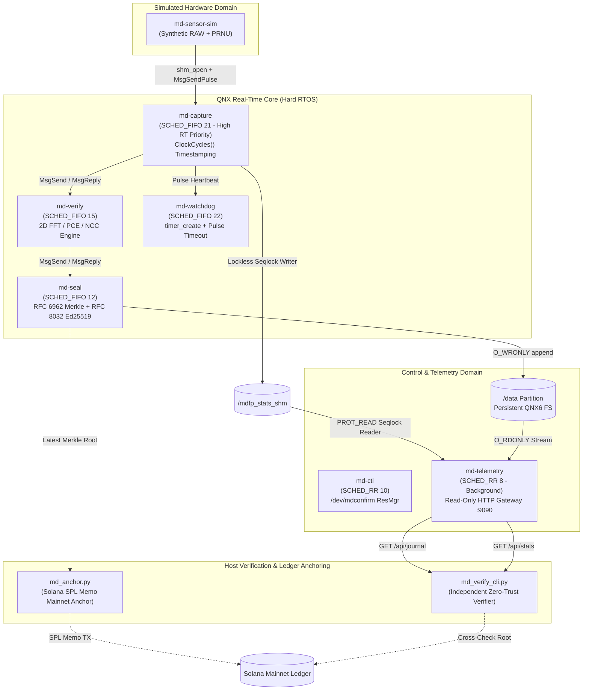

Built for the QNX Global Hackathon. Not affiliated with BlackBerry or QNX.

# MD-Confirm RTOS: Hardware-Rooted Camera Authenticity for ADAS on BlackBerry QNX 8.0

**Hackathon Entry:** BlackBerry QNX Global Hackathon 2026  
**Author:** miracledropletmd  
**Primary Track:** Automotive & Mobility (ADAS Black Box & Crash Evidence Sealing)  
**Target Special Prize:** Best Use of QNX-specific Technologies ($3,500)  

---

## 1. Project Overview

**MD-Confirm RTOS** is a modular microkernel security framework built natively for **BlackBerry QNX Neutrino RTOS 8.0**. At the exact nanosecond a RAW Bayer frame is ingested from the image sensor, the system verifies its atomic silicon wafer fingerprint (Photo-Response Non-Uniformity, PRNU), measures hardware bus transit determinism via `ClockCycles()`, signs canonical RFC 8785 metadata with RFC 8032 Ed25519 digital signatures, and aggregates frames into an RFC 6962 Merkle tree persistently recorded to disk and anchored to the public Solana blockchain.

* **What we prove:** The frame was captured by a specific, calibrated physical silicon sensor and has not been altered since DMA delivery into kernel memory.
* **What we do NOT prove:** That the physical scene in front of the lens is authentic (e.g., pointing a physical camera at an iPad screen is outside the cryptographic perimeter).

---

## 2. Границы применимости (Boundaries of Applicability) & Threat Model

In mission-critical embedded systems and forensic computing, acknowledging threat limits and boundaries is a hallmark of architectural honesty:

* **Sensor-to-Memory Scope:** The system validates that a frame originates from a specific physical sensor wafer and that the record has not been altered after sealing. It does **not** authenticate physical scene reality (e.g. physical optical playback or projectors in front of the lens require active LiDAR/depth sensors).
* **Simulation in QEMU x86_64:** All test scenarios and pipeline benchmarks are demonstrated on **SYNTHETIC frames** inside QEMU x86_64 running QNX SDP 8.0. Latency and jitter measurements obtained inside a virtual machine do not substitute for bare-metal hardware validation.
* **Scenario 4 (Synthetic Injection with Pre-applied Noise):** Detection of synthetic injection with pre-calculated $K_{REF}$ noise is triggered primarily by modeled frame interval jitter. A sophisticated hardware attacker possessing pre-recorded calibration frames and a custom FPGA bus emulator operates on the boundary of this software defense perimeter.
* **Key Protection Model:** On the hackathon evaluation bench, protection of the device Ed25519 signing key and reference pattern $K_{REF}$ is file-based. Production deployment requires integration with hardware Secure Boot and a dedicated Hardware Security Module (HSM) or TPM 2.0.
* **Journal Property:** The forensic evidence journal is **tamper-evident**, not physically immutable WORM media. Any modification or truncation is mathematically detected upon verification, but physical write-protection relies on the underlying storage controller.

| # | Threat Scenario | Detected? | Technical Mechanism & Rationale |
|---|-----------------|-----------|----------------------------------|
| 1 | Frame from another physical camera (Silicon swap) | **YES** | Low Peak-to-Correlation Energy ($PCE < 60.0$ linear / $< 17.78$ dB) relative to calibrated $K_{REF}$ |
| 2 | Synthetic AI deepfake (no silicon noise) | **YES** | Zero silicon wafer PRNU noise signature ($PCE \ll 17.78$ dB, $NCC \approx 0.01$) |
| 3 | Frame alteration after ingestion | **YES** | Cryptographic hash divergence in RFC 6962 Merkle tree leaf |
| 4 | Synthetic frame with pre-applied $K_{REF}$ noise | **BOUNDARY** | PRNU matches; caught only in coarse cases via frame rhythm & injection latency spikes |
| 5 | Optical playback in front of lens (screen attack) | **BOUNDARY** | Outside silicon sensor perimeter (requires active optical depth sensing) |
| 6 | Hardware bus emulator on FPGA with precise rhythm | **BOUNDARY** | Physical CSI-2 bus timing can be mimicked by custom FPGA hardware |
| 7 | MIPI cable severed or camera power loss | **YES** | `md-watchdog`: Asynchronous QNX pulse timeout (> 50 ms) trips emergency `GHOST_EVENT` |
| 8 | Tampering with stored records after capture | **YES** | RFC 6962 Merkle Tree root mismatch & RFC 8032 Ed25519 signature failure detected by independent verifier |
| 9 | Root exploit on node / private key extraction | **BOUNDARY** | Requires hardware TPM 2.0 / Secure Enclave & Secure Boot (on production roadmap) |

---

## 3. Native QNX 8.0 Microkernel Architecture

MD-Confirm RTOS leverages QNX Neutrino's true microkernel architecture, splitting security responsibilities into 7 isolated processes communicating via native IPC:



### Safety Decoupling (Real-Time vs Network Serving):
* **Strict Real-Time Isolation (`md-capture`):** Runs at a **высокий приоритет реального времени** (`SCHED_FIFO 21`). It contains **zero** network sockets or client threads. Frame ingestion and `ClockCycles()` measurement cannot be interrupted by network traffic.
* **Lock-Free Seqlock IPC (`/mdfp_stats_shm`):** `md-capture` updates telemetry and jitter metrics using a lock-free sequential lock (`seqlock`). The writer increments an atomic sequence counter before and after copying data (odd = write in progress; even = valid snapshot). `md-capture` never waits, takes mutexes, or yields to background readers.
* **Low-Priority Read-Only Telemetry (`md-telemetry`):** Runs at background priority `SCHED_RR 8` (`MDFP_PRIO_TELEMETRY`), listening on `0.0.0.0:9090` (configurable via `--bind`).
  * **Memory Isolation:** Maps `/mdfp_stats_shm` strictly read-only (`PROT_READ`). Readers retry reads if the writer was active.
  * **Journal Isolation:** Opens `/data/mdfp_evidence/tamper_evident_journal.log` strictly `O_RDONLY` (configurable via `--journal`).
  * **Key Zero-Exposure:** `md-telemetry` has zero access to the device private key `g_device_sk` (held exclusively in `md-seal`).
  * **Network Hardening:** POSIX sockets serve **only GET** requests (`/api/journal`, `/api/stats`, `/api/health`). Non-GET methods return `405 Method Not Allowed`; unknown endpoints return `404 Not Found`. Socket limits: 4 KB request buffer, 2-second timeout (`SO_RCVTIMEO`), max 8 connection backlog, `Connection: close`.
  * **Crash Immunity:** If `md-telemetry` crashes or is killed via `slay`, `md-capture` continues running with zero jitter degradation.

---

## 4. Evidence of QNX-specific Technologies Use

This implementation relies directly on proprietary and POSIX-compliant QNX Neutrino RTOS microkernel primitives:

| QNX Technology / Native API | Source File | Line Number | Concrete Architectural Purpose |
|-----------------------------|-------------|-------------|--------------------------------|
| `resmgr_attach()` | [`qnx/ctl/md-ctl.cpp`](file:///c:/Users/User/work/md-confirm-rtos/qnx/ctl/md-ctl.cpp#L115) | Line 115 | Registers QNX Resource Manager at `/dev/mdconfirm` to expose control interfaces via standard POSIX `read()`/`devctl()` |
| `MsgSendPulse()` | [`qnx/sensor-sim/md-sensor-sim.cpp`](file:///c:/Users/User/work/md-confirm-rtos/qnx/sensor-sim/md-sensor-sim.cpp#L138) | Line 138 | Non-blocking asynchronous hardware interrupt simulation delivery (EOF IRQ) into `md-capture` |
| `ClockCycles()` | [`qnx/capture/md-capture.cpp`](file:///c:/Users/User/work/md-confirm-rtos/qnx/capture/md-capture.cpp#L94) | Line 94 | High-precision hardware cycle counter for bus transit latency and jitter timestamping |
| `timer_create()` + `SIGEV_PULSE` | [`qnx/watchdog/md-watchdog.cpp`](file:///c:/Users/User/work/md-confirm-rtos/qnx/watchdog/md-watchdog.cpp#L55) | Line 55 | Real-time periodic hardware pulse watchdog; trips emergency `GHOST_EVENT` if frame arrival exceeds 50 ms deadline |
| `shm_open()` + `mmap()` (Zero-Copy) | [`qnx/sensor-sim/md-sensor-sim.cpp`](file:///c:/Users/User/work/md-confirm-rtos/qnx/sensor-sim/md-sensor-sim.cpp#L48) | Lines 48, 54 | High-performance zero-copy shared memory buffer (`/mdfp_frame_shm`) for 16-bit RAW Bayer frame delivery |
| `shm_open()` + `mmap()` (Seqlock) | [`qnx/capture/md-capture.cpp`](file:///c:/Users/User/work/md-confirm-rtos/qnx/capture/md-capture.cpp#L46) | Lines 46, 58 | Lock-free real-time stats publication (`/mdfp_stats_shm`) read strictly `PROT_READ` by `md-telemetry` |

---

## 5. PRNU Signal Metrics, Dimensionless PCE & Calibration Limits

### Metric Units and Standard Literature Thresholds:
* **Normalized Cross-Correlation (NCC):** Dimensionless coefficient $[-1.0, 1.0]$ measuring normalized spatial noise alignment.
* **Peak-to-Correlation Energy (PCE):** Dimensionless energy ratio ($\text{peak}^2 / \text{mean sidelobe energy}$) established by J. Fridrich and M. Goljan. Literature standard threshold is $\text{PCE} \ge 60$ (linear), which corresponds to $\approx 17.78\text{ dB}$ ($10 \log_{10}(60)$).
* In MD-Confirm RTOS:
  * `pce_linear` and `pce_db` are both computed and recorded per frame.
  * Default synthetic test thresholds: $\text{NCC} \ge 0.75$, $\text{PCE} \ge 60.0$ linear ($17.78\text{ dB}$).

### Synthetic Simulation vs Bare-Metal CMOS Calibration:
> **Engineering Calibration Notice:** The values reported in this demonstration ($\text{NCC} \approx 0.78$–$0.98$, $\text{PCE} \approx 34$–$36\text{ dB}$) are measured on synthetic calibration patterns where the wafer noise pattern is unattenuated by scene textures. On physical automotive CMOS sensors (e.g., Sony IMX390 / ON Semi AR0820), scene clutter reduces the observable PRNU signal-to-noise ratio. Production deployment requires empirical Receiver Operating Characteristic (ROC) curve calibration (False Acceptance Rate vs False Rejection Rate) on standardized ISO 12233 targets across temperatures ($-40^\circ\text{C}$ to $+85^\circ\text{C}$).

---

## 6. Independent Zero-Trust Verifier & Ed25519 Hardware Signatures

The verification architecture enforces a strict **Zero-Trust** model:
1. **Never Trust the Node:** The verifier does not assume the local QNX node or HTTP server (`127.0.0.1:9090`) is honest.
2. **Pinned Root-of-Trust Public Key:** Every record in the journal contains an authentic RFC 8032 Ed25519 signature generated inside QNX Neutrino using TweetNaCl:
   * Device Public Key: `7ea81ac6c1fc3a9a567a7693e3d930a5c140a3a05fa270d763f291160696a468`
3. **Independent Merkle Recalculation:** The CLI recomputes the RFC 6962 binary Merkle tree across all leaf hashes. If any bit in the frame metadata, sequence, or recorded root is modified, the tree diverges immediately.
4. **Factual Engineering Verdict:** Replaces marketing claims with factual technical assertions:
   `root and signature verified [PASS]` or `root, signature, and on-chain anchor verified [PASS]`.

---

## 7. Real Solana Mainnet On-Chain Anchoring

To provide external auditability and prevent unilateral local history rewriting, the Merkle root is periodically anchored to the **Solana Mainnet** ledger via native SPL Memo v1 instructions:

* **Live Solana Mainnet Transaction:**
  * **TX Signature:** [`4N4vyHbz3wvMnR6736uePmRPtNdr6Fo6ujk62h1cPhF9tdoUUAicZX7oGwZD4AdRLdkKMC8nD1eEn7Kgb46SPiZW`](https://solscan.io/tx/4N4vyHbz3wvMnR6736uePmRPtNdr6Fo6ujk62h1cPhF9tdoUUAicZX7oGwZD4AdRLdkKMC8nD1eEn7Kgb46SPiZW)
  * **On-Chain Memo:** `MDFP1|QNX-ADAS-NODE-01|402d8962082755e0ea3e138a8f1aa4c4e376f6b683f16ed00efd25fc4a91c7d3|3568`
  * **Solana Cluster:** `Mainnet-Beta` (confirmed on public decentralized RPC)
  * **Anchoring SLA:** Solana slot duration $\approx 400\text{ ms}$, consensus finality $\approx 12\text{ s}$.

### Verifier Command with On-Chain Cross-Check:
```bash
python3 host/verify-cli/md_verify_cli.py --source http://127.0.0.1:9090/api/journal \
  --solana-tx 4N4vyHbz3wvMnR6736uePmRPtNdr6Fo6ujk62h1cPhF9tdoUUAicZX7oGwZD4AdRLdkKMC8nD1eEn7Kgb46SPiZW
```

---

## 8. What We Do NOT Claim

* We do **NOT** claim ASIL-D or SIL 3 certification for our hackathon project. ASIL-D certification applies to commercial QNX OS for Safety products.
* We do **NOT** claim "100% unbreakable security" or a "single point of failure-free" architecture.
* We do **NOT** claim hardware cryptographic key protection on the demonstration VM (hardware TPM 2.0 / HSM is specified on our production roadmap).
* The forensic journal is **tamper-evident**, not immutable WORM hardware.
