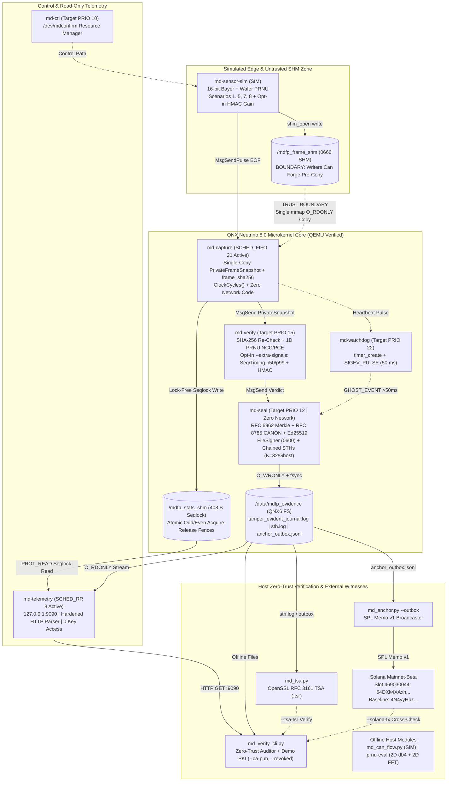
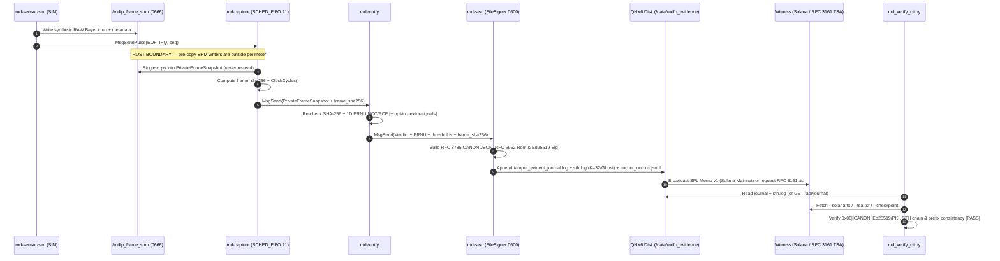

Built for the QNX Global Hackathon. Not affiliated with BlackBerry or QNX.

# MD-Confirm RTOS — Sensor-Bound Camera Attestation & Tamper-Evident Event Log on QNX 8.0

[](https://github.com/CenterDigitalTrust/MD-Confirm-RTOS/actions/workflows/ci.yml)

-d29922?style=flat-square)

[](LICENSE)

**Hackathon Entry:** BlackBerry QNX Global Hackathon 2026  
**Author:** `miracledropletmd` ([Center for Digital Trust](https://github.com/CenterDigitalTrust/MD-Confirm-RTOS) | `MIRACLE DROPLET MD®`, CIPO #2405513 CANADA)  
**Primary Track:** Automotive & Mobility (ADAS Black Box & Crash Evidence Sealing)  
**Target Special Prize:** Best Use of QNX-specific Technologies (\$3,500)

---

## Quick Start

```bash
# 1. Cross-compile all 7 native QNX 8.0 binaries (requires BlackBerry QNX SDP 8.0)
source /path/to/qnxsdp-8.0/qnxsdp-env.sh
cd qnx && make clean && make all && cd ..

# 2. Run QNX scenario suite inside QNX 8.0 QEMU (Phase 1 PRNU + Phase 2 --extra-signals)
./run_all_scenarios.sh

# 3. Independently verify the captured QNX 8.0 QEMU journal against Solana Mainnet-Beta (no QNX SDP required)
pip install cryptography
python3 host/verify-cli/md_verify_cli.py \
  --source docs/evidence/qnx_8_qemu/tamper_evident_journal.log \
  --sth-log docs/evidence/qnx_8_qemu/sth.log \
  --solana-tx 54DXk4XAxhuQNDrbTqRXZmPFvEDMFVwxa6FLz1vMT6fjzUzepLivCGgGKAJgjgYQKv96TegrCNoCnyowxbEyiXbT

# 4. Run host Python verification suite (no QNX SDP required)
pytest -v tests/python
```

> **Trust Boundary, Limitations & Calibration Status:** See [`docs/TRUST_BOUNDARY.md`](docs/TRUST_BOUNDARY.md) (inside vs. outside boundary, SHM forging risks, `FileSigner` vs. `ROADMAP` hardware keys), [`docs/LIMITATIONS.md`](docs/LIMITATIONS.md), [`docs/PRNU_RESULTS.md`](docs/PRNU_RESULTS.md), and [`docs/CHANGELOG_UPGRADE.md`](docs/CHANGELOG_UPGRADE.md).  
> **Captured Evidence:** Upgraded QNX 8.0 QEMU + host + Solana Mainnet proof artifacts live in [`docs/evidence/qnx_8_qemu/`](docs/evidence/qnx_8_qemu/); historical baseline artifacts live in [`docs/evidence/`](docs/evidence/).

---

## 1. Project Overview

**MD-Confirm RTOS** is a modular microkernel security pipeline built for **BlackBerry QNX Neutrino RTOS 8.0**. When a frame arrives in POSIX shared memory, `md-capture` copies it once into a private snapshot buffer (`PrivateFrameSnapshot`), hashes that private copy (`frame_sha256`), forwards the immutable snapshot over QNX IPC to `md-verify` for statistical PRNU attribution (and optional signal checks), stamps cycle counts via `ClockCycles()`, seals RFC 8785 JCS canonical leaf metadata into a strict RFC 6962 Merkle tree signed with Ed25519 inside `md-seal`, and emits chained Signed Tree Heads (`sth.log`) plus offline anchor requests (`anchor_outbox.jsonl`) for external witnessing via RFC 3161 TSA or **Solana Mainnet-Beta**.

* **What this software demo proves (`SIMULATED`):** Every Ed25519 signature proves **"this node (`md-seal`) accepted these exact bytes (`frame_sha256` + canonical RFC 8785 metadata) at this time"**, and pixel residual correlation statistically matches a synthetic reference sensor pattern ($K_{\text{REF}}$). Modification, rollback, and tail-truncation detection hold **strictly relative to an external checkpoint** (`--checkpoint`, `--solana-tx`, or `--tsa-tsr`).
* **What this software demo does NOT prove:** That writers to `/mdfp_frame_shm` are uncompromised *before* `md-capture` copies a frame (there is no real DMA or MIPI CSI-2 hardware), hardware-protected private keys (software `FileSigner` only; `HardwareTokenSignerStub` is `ROADMAP` and `swtpm` is emulation only), or physical scene reality in front of the lens.

---

## 2. Boundaries of Applicability & Threat Model

Transparent engineering boundaries keep security guarantees grounded in verifiable behavior:

* **Sensor-to-Memory Perimeter:** The verifier checks statistical silicon noise (PRNU) and cryptographic log integrity. Optical playback in front of a physical lens requires active depth sensing (`BOUNDARY`, partially explored in [`host/can-flow/`](host/can-flow/) as `SIMULATED`).
* **QEMU x86_64 Execution (`SIMULATED`):** All QNX binaries were compiled with **QNX SDP 8.0** and executed inside **QEMU x86_64** on synthetic Bayer frames; bare-metal determinism, automotive temperature ROC ($-40^\circ\text{C}$ to $+85^\circ\text{C}$), and Dresden/VISION real-dataset ROC remain **`NOT YET MEASURED`**.
* **Scenario 4 (`K_REF` Fingerprint-Copy Spoof):** By default (PRNU-only), blocking pre-applied $K_{\text{REF}}$ injection is **`ROADMAP`** (`allow = true` with real $N_{\text{attack}}$ curves `NOT YET MEASURED` in [`host/prnu-eval/`](host/prnu-eval/)). With opt-in `--extra-signals` (`SIMULATED`), forged $K_{\text{REF}}$ frames lacking matching `HMAC(secret, frame_seq)` gain modulation fail `BLOCK_CHALLENGE_MODULATION` (verified in QNX 8.0 QEMU).
* **Key Protection Model (Software Keys Only):** `md-seal` uses [`qnx/common/mdfp_signer.h`](qnx/common/mdfp_signer.h) (`FileSigner` software TweetNaCl keys; refuses group- or world-readable key files where POSIX `mode & 0077 != 0`, auto-provisioning the demo key at `0600` if absent). **There is no hardware key protection today** (`HardwareTokenSignerStub` for PKCS#11 / TPM 2.0 / Secure Element is `ROADMAP`; `swtpm` is software emulation only).
* **Tamper-Evident Journal Property:** The log is **tamper-evident**, not immutable WORM media. Integrity against tail truncation or rollback holds **only relative to an external checkpoint** (`--checkpoint STH_FILE`, `--solana-tx`, or `--tsa-tsr` + `--tsa-ca`).

| # | Threat Scenario | PRNU only | PRNU + extra signals | Technical Mechanism & Rationale |
|---|---|---|---|---|
| 1 | Frame from another physical camera (Silicon swap) | **YES** (`SIMULATED`) | **YES** (`SIMULATED`) | Low Peak-to-Correlation Energy ($\text{PCE} < 60.0$ linear / $< 17.78\text{ dB}$) relative to $K_{\text{REF}}$ |
| 2 | Synthetic AI deepfake (no silicon noise) | **YES** (`SIMULATED`) | **YES** (`SIMULATED`) | Flat synthetic frame yields negligible PRNU correlation ($\text{PCE} \ll 17.78\text{ dB}$, $\text{NCC} \approx 0.01$) |
| 3 | Frame alteration after ingestion copy | **YES (IPC boundary)** (`SIMULATED`, QNX 8.0 QEMU verified) | **YES (IPC boundary)** (`SIMULATED`, QNX 8.0 QEMU verified) | `md-capture` copies `/mdfp_frame_shm` once into `PrivateFrameSnapshot` and hashes before IPC; `md-verify` makes zero SHM reads and re-checks `SHA-256 == frame_sha256` (`BLOCK_INGEST_HASH_MISMATCH`). Pre-copy writes to `/mdfp_frame_shm` stay outside the boundary ([`docs/TRUST_BOUNDARY.md`](docs/TRUST_BOUNDARY.md)) |
| 4 | Synthetic frame with pre-applied $K_{\text{REF}}$ noise (fingerprint-copy attack) | **NO / `ROADMAP`** | **YES** (`SIMULATED`, `--extra-signals` off by default) | PRNU passes by construction (real-dataset $N_{\text{attack}}$ is `NOT YET MEASURED` in [`host/prnu-eval/`](host/prnu-eval/)). With opt-in `--extra-signals`, frames without valid `HMAC(secret, frame_seq)` gain modulation fail `BLOCK_CHALLENGE_MODULATION`. Shared-secret sim demonstrates logic only; real per-frame sensor support is unverified |
| 5 | Optical playback in front of lens (screen attack) | **BOUNDARY** | **BOUNDARY** (partial `SIMULATED` CAN check on host) | Outside silicon sensor perimeter (needs active optical depth sensing); host-only `SIMULATED` Lucas-Kanade optical flow vs. synthetic CAN wheel speed ([`host/can-flow/`](host/can-flow/)) flags motion mismatch (`nrmse 0.9065`) |
| 6 | Hardware bus emulator on FPGA with precise rhythm | **BOUNDARY** | **BOUNDARY** (without HW sensor secret) | Physical CSI-2 bus timing can be mimicked by FPGA hardware; software shared-secret challenge-response does not protect against key compromise |
| 7 | MIPI cable severed or camera power loss | **YES** (`SIMULATED`) | **YES** (`SIMULATED`) | `md-watchdog`: Asynchronous QNX pulse timeout ($> 50\text{ ms}$) dispatches emergency `GHOST_EVENT` |
| 8 | Tampering with stored records after capture | **YES relative to external checkpoint** (`SIMULATED`, QNX + host verified) | **YES relative to external checkpoint** (`SIMULATED`, QNX + host verified) | Rejects modified metadata (`CANON` vs. `LEAF`), duplicate leaves, swapped/renumbered records, invalid Ed25519 signatures, broken `prev_sth_sha256` STH chains, and rollback/tail truncation relative to `--checkpoint`, `--solana-tx`, or `--tsa-tsr` via strict RFC 6962 inclusion & consistency proofs (`source: none` emits `WARNING`) |
| 9 | Root exploit on node / private key extraction | **BOUNDARY** | **BOUNDARY** | `FileSigner` uses filesystem keys with no hardware key protection (`swtpm` is emulation only; PKCS#11 / TPM 2.0 / SE = `ROADMAP`) |
| 10 | Replay of previously recorded authentic frames (same $K_{\text{REF}}$) | **NO** | **YES** (`SIMULATED`, `--extra-signals` off by default) | Recorded authentic frames carry valid $K_{\text{REF}}$. With `--extra-signals` ([`qnx/common/mdfp_signals.h`](qnx/common/mdfp_signals.h), verified in QNX 8.0 QEMU), verbatim replays fail `BLOCK_SEQ_REPLAY`, skips/timing faults fail `BLOCK_SEQ_GAP` / `BLOCK_TIMING_OUT_OF_BOUNDS`, and re-stamped frames fail `BLOCK_CHALLENGE_MODULATION` |

---

## 3. Native QNX 8.0 Microkernel Architecture


MD-Confirm RTOS splits capture, signal verification, fault monitoring, notarization, control, telemetry, and external auditing across MMU-isolated processes communicating via POSIX shared memory and native QNX Neutrino message passing (`MsgSend` / `MsgReceive` / `MsgSendPulse`):



### Trust-Boundary & Checkpointed Evidence Sequence



### Safety Decoupling (Real-Time vs. Network Serving):
* **Real-Time Ingestion (`md-capture`):** Executes at active `SCHED_FIFO 21` (`MDFP_PRIO_CAPTURE`) with **zero** network sockets or HTTP threads (`qnx/capture/md-capture.cpp`).
* **Lock-Free Atomic Seqlock (`/mdfp_stats_shm`):** `md-capture` publishes 408-byte telemetry snapshots via [`qnx/common/mdfp_seqlock.h`](qnx/common/mdfp_seqlock.h) using C++17 `std::atomic` odd/even sequence counters (`acquire`/`release`) and atomic 64-bit words. **`md-capture` never waits on telemetry readers (seqlock)** (note: downstream capture IPC calls synchronous blocking `MsgSend()` into `md-verify` and `md-seal`).
* **Decoupled Read-Only Telemetry (`md-telemetry`):** Executes at background `SCHED_RR 8` (`MDFP_PRIO_TELEMETRY`), binding `127.0.0.1:9090` by default (`--bind` to override). Maps `/mdfp_stats_shm` `PROT_READ`, opens the journal `O_RDONLY`, has zero access to the Ed25519 private key, and enforces strict GET-only parsing via [`qnx/common/mdfp_http.h`](qnx/common/mdfp_http.h) (`400`/`414`/`405`/`404`, 4 KB buffer, 2 s `SO_RCVTIMEO`/`SO_SNDTIMEO`). Killing `md-telemetry` via `slay` leaves capture uninterrupted ([`docs/evidence/pidin.txt`](docs/evidence/pidin.txt)).

---

## 4. Evidence of QNX-Specific Technologies Use

| QNX Technology / Native API | Source Location (`HEAD`) | Concrete Architectural Purpose |
|---|---|---|
| `resmgr_attach()` | [`qnx/ctl/md-ctl.cpp#L115`](qnx/ctl/md-ctl.cpp#L115) | Registers QNX Resource Manager at `/dev/mdconfirm` for POSIX `read()`/`write()` control |
| `MsgSendPulse()` | [`qnx/sensor-sim/md-sensor-sim.cpp#L313`](qnx/sensor-sim/md-sensor-sim.cpp#L313) | Non-blocking asynchronous simulated EOF interrupt pulse delivery into `md-capture` |
| `ClockCycles()` | [`qnx/capture/md-capture.cpp#L119`](qnx/capture/md-capture.cpp#L119) | High-resolution hardware cycle counter for ingestion latency & `p50`/`p99` interval tracking |
| `timer_create()` + `SIGEV_PULSE` | [`qnx/watchdog/md-watchdog.cpp#L60`](qnx/watchdog/md-watchdog.cpp#L60) | Real-time periodic kernel timer watchdog; trips emergency `GHOST_EVENT` on $> 50\text{ ms}$ frame stall |
| `shm_open()` + `mmap()` (Frame SHM) | [`qnx/sensor-sim/md-sensor-sim.cpp#L123`](qnx/sensor-sim/md-sensor-sim.cpp#L123) | Shared memory buffer (`/mdfp_frame_shm`) read once into `PrivateFrameSnapshot` (`qnx/capture/md-capture.cpp#L52`) |
| `shm_open()` + `mmap()` (Seqlock) | [`qnx/capture/md-capture.cpp#L62`](qnx/capture/md-capture.cpp#L62) | Lock-free atomic stats SHM (`/mdfp_stats_shm`) mapped strictly `PROT_READ` in [`qnx/telemetry/md-telemetry.cpp#L130`](qnx/telemetry/md-telemetry.cpp#L130) |
| `MsgReceive()` / `MsgSend()` | [`qnx/verify/md-verify.cpp#L117`](qnx/verify/md-verify.cpp#L117) | Native QNX IPC channels across `md-capture` → `md-verify` → `md-seal` (`qnx/seal/md-seal.cpp#L119`), hardened against `_PULSE_CODE_DISCONNECT` |

*(Archived hackathon baseline permalinks remain preserved at commit [`8da9c5bd`](https://github.com/CenterDigitalTrust/MD-Confirm-RTOS/tree/8da9c5bd0c1a03d509cb047a0e5b17f17dab8315/qnx).)*

---

## 5. Verification Results & Live Evidence Matrix (`SIMULATED` vs. On-Chain vs. `NOT YET MEASURED`)

| Verification Layer | Observed Result / Scope | Primary Evidence / Command | Status |
|---|---|---|---|
| **Native QNX SDP 8.0 Build** | All 7 x86_64 QNX ELF binaries compiled (`make clean && make all`, 0 warnings) | [`qnx/Makefile`](qnx/Makefile), [`BUILD.md`](BUILD.md) | **Verified (`QNX SDP 8.0`)** |
| **Live QNX 8.0 QEMU Run** | `65` sealed leaves, `10` chained STHs, `10` outbox entries; Phase 1 (`Scen 1..3, 5`) + Phase 2 (`--extra-signals`: `Scen 1, 4, 7, 8`); `frames_verified=56`, `deepfakes_blocked=35`, `p50=34419 µs`, `p99=245225 µs` | [`docs/evidence/qnx_8_qemu/`](docs/evidence/qnx_8_qemu/), [`api_stats_extra_signals.json`](docs/evidence/qnx_8_qemu/api_stats_extra_signals.json), [`capture.log`](docs/evidence/qnx_8_qemu/capture.log), [`seal.log`](docs/evidence/qnx_8_qemu/seal.log), [`watchdog.log`](docs/evidence/qnx_8_qemu/watchdog.log) | **`SIMULATED` (QNX 8.0 QEMU)** |
| **Host Verifier, OpenSSL TSA & Demo PKI** | `md_verify_cli.py` passes on live 65-leaf journal with `ckpt_32`, OpenSSL RFC 3161 `.tsr`, and `--ca-pub`/`--device-cert`; rejects tail truncation (`64 < 65`), metadata tamper, and `--revoked` key (`rc=2`); validates key rotation & `md_anchor.py --outbox --dry-run` | [`host_verification_summary.txt`](docs/evidence/qnx_8_qemu/host_verification_summary.txt), [`host/tsa/md_tsa.py`](host/tsa/md_tsa.py), [`host/pki/md_demo_pki.py`](host/pki/md_demo_pki.py) | **Verified (Linux + QNX log, `DEMO ONLY` PKI)** |
| **Optical Flow vs. CAN Speed** | `matched_authentic` passes (`nrmse=0.0034`, `r=1.0000`); `replay_mismatched_can` flagged (`nrmse=0.9065`, `r=-1.0000`) | [`can_flow_demo_report.json`](docs/evidence/qnx_8_qemu/can_flow_demo_report.json), [`host/can-flow/md_can_flow.py`](host/can-flow/md_can_flow.py) | **`SIMULATED` (Host Only)** |
| **Solana Mainnet-Beta Anchor** | 65-leaf QNX 8.0 QEMU root anchored in **Slot `469030044`** (`err: null`) and cross-verified via Mainnet RPC (`rc=0`; `64/65` truncation rejected `rc=2`) | [`mainnet_anchor_receipt.json`](docs/evidence/qnx_8_qemu/mainnet_anchor_receipt.json) ([TX on Solscan](https://solscan.io/tx/54DXk4XAxhuQNDrbTqRXZmPFvEDMFVwxa6FLz1vMT6fjzUzepLivCGgGKAJgjgYQKv96TegrCNoCnyowxbEyiXbT)) | **Verified Live (`Mainnet-Beta`)** |
| **Host Unit Suites & Sanitizers** | `40` Python tests on Linux (`39 passed, 1 skipped` on Windows where OpenSSL CLI is absent) + `8` C++ host tests (`-Wall -Wextra -Werror`, ASan/UBSan on Linux & MinGW on Windows) + TSan seqlock & `libFuzzer` in GitHub Actions | [`.github/workflows/ci.yml`](.github/workflows/ci.yml), [`tests/python/`](tests/python/), [`tests/cpp/`](tests/cpp/) | **Verified (Host CI)** |
| **Real Camera & Bare-Metal Hardware** | Real Dresden/VISION 2D PRNU ROC, automotive CMOS temperature sweep ($-40^\circ\text{C}\dots+85^\circ\text{C}$), bare-metal WCET, PKCS#11 HSM / TPM 2.0 keys, and MIPI CSI-2 DMA | [`docs/PRNU_RESULTS.md`](docs/PRNU_RESULTS.md), [`docs/LIMITATIONS.md`](docs/LIMITATIONS.md), [`docs/CHANGELOG_UPGRADE.md`](docs/CHANGELOG_UPGRADE.md) | **`NOT YET MEASURED` / `ROADMAP`** |

---

## 6. Why QNX

1. **Process Isolation & Memory Fault Resilience:** Security daemons run in separate MMU-isolated QNX processes, and `md-telemetry` maps `/mdfp_stats_shm` strictly `PROT_READ`. Killing `md-telemetry` via `slay` leaves `md-capture` and `md-seal` unaffected ([`docs/evidence/pidin.txt`](docs/evidence/pidin.txt), [`docs/evidence/jitter_baseline.json`](docs/evidence/jitter_baseline.json), [`docs/evidence/jitter_under_100_curls.json`](docs/evidence/jitter_under_100_curls.json)).
2. **Priority Preemptive Scheduling:** `md-capture` explicitly configures `SCHED_FIFO 21` while `md-telemetry` configures background `SCHED_RR 8` (`MDFP_PRIO_*` constants in [`qnx/common/mdfp_protocol.h`](qnx/common/mdfp_protocol.h)), preventing local HTTP traffic from preempting frame ingestion (QEMU scheduling shows ms-scale VM variance; bare-metal latency is `NOT YET MEASURED`).
3. **Native Message Passing (`MsgSend` / `MsgReceive`):** Pipeline stages (`md-capture` → `md-verify` → `md-seal`, `md-watchdog` → `md-seal`) use native QNX channels without loopback TCP sockets; IPC paths explicitly handle `_PULSE_CODE_DISCONNECT` and `ConnectDetach()`.
4. **Asynchronous Kernel Timer Pulses (`timer_create` + `SIGEV_PULSE`):** `md-watchdog` monitors frame cadence with `CLOCK_MONOTONIC` pulses and triggers `GHOST_EVENT` logging whenever arrivals stall beyond `50 ms`.

---

## 7. Known Limitations, PRNU Calibration & Extra Signals (`SIMULATED`)

* **Known Limitations Summary ([`docs/LIMITATIONS.md`](docs/LIMITATIONS.md)):** Synthetic frames in `0666` `/mdfp_frame_shm` (no MIPI CSI-2 / DMA hardware), QEMU virtualization timing, software `FileSigner` (`0600` POSIX check; no HW keys), synchronous `MsgSend()` pipeline with $O(N)$ Merkle recomputation per seal, localhost telemetry without pagination, and persistent `/data` partition dependency.
* **PRNU Signal Metrics & Harness:** Standard literature thresholds use dimensionless **NCC** $\ge 0.75$ and **PCE** $\ge 60.0$ linear ($\approx 17.78\text{ dB}$, $10\log_{10}(60)$). While online `md-verify` computes a fast 1D 3-sample residual dot product (`NCC ~ 0.785–0.790`, `PCE ~ 34.0–34.1 dB` on synthetic Bayer inputs), [`host/prnu-eval/`](host/prnu-eval/) provides a full offline 2D evaluation suite (`pywt` `db4` Mihcak denoising, weighted MLE reference $K$, row/col zero-mean normalization, 2D FFT PCE with `11x11` exclusion) ready for Dresden / VISION real-camera corpora (`python -m prnu_eval --dataset PATH --out docs/evidence/prnu/`, results **`NOT YET MEASURED`** in [`docs/PRNU_RESULTS.md`](docs/PRNU_RESULTS.md)).
* **Optional Simulated Extra Signals (`--extra-signals`, Off by Default):** Implemented in [`qnx/common/mdfp_signals.h`](qnx/common/mdfp_signals.h) and verified in both C++ host tests and QNX 8.0 QEMU: monotonic zero-gap `frame_seq`, configurable `ClockCycles()` interval bounds with sliding-window `p50`/`p99` reporting, and `HMAC-SHA256(secret, frame_seq)` per-frame gain modulation (`BLOCK_CHALLENGE_MODULATION` on forged/unmodulated frames, `BLOCK_SEQ_REPLAY` on replays). **Explicit disclaimer:** real camera per-frame gain synchronization is unverified (`NOT YET MEASURED`), and sharing a symmetric secret between `md-sensor-sim` and `md-verify` models verification logic only, not hardware security. Offline [`host/can-flow/md_can_flow.py`](host/can-flow/md_can_flow.py) provides `SIMULATED` Lucas-Kanade optical flow vs. CAN wheel-speed checks.

---

## 8. Independent Verifier, PKI (`DEMO ONLY`) & Append-Only Log

1. **Trust Basis (Relative to External Checkpoint):** `md_verify_cli.py` requires `--checkpoint STH_FILE`, `--solana-tx`, or `--tsa-tsr` + `--tsa-ca` to prove absence of tail truncation or rollback (`WARNING: tail truncation NOT detectable.` when `source: none`).
2. **Pinned Key & Demo PKI (`DEMO ONLY — NOT FOR PRODUCTION USE`):**
   * Default Pinned Device Public Key: `7ea81ac6c1fc3a9a567a7693e3d930a5c140a3a05fa270d763f291160696a468`
   * [`host/pki/md_demo_pki.py`](host/pki/md_demo_pki.py) creates an offline software Ed25519 CA, issues signed JSON device certificates (`device_id`, `public_key`, `not_before`, `not_after`, `key_id`), publishes revocation lists, and supports key rotation (`old_key` or `ca`), checked via `--ca-pub`, `--device-cert`, `--revoked`, and `--rotation`.
3. **Strict RFC 6962, RFC 8785 & RFC 3161:** [`host/verify-cli/merkle_rfc6962.py`](host/verify-cli/merkle_rfc6962.py), [`qnx/common/mdfp_merkle.h`](qnx/common/mdfp_merkle.h), and [`qnx/common/mdfp_seal_core.h`](qnx/common/mdfp_seal_core.h) enforce strict RFC 6962 proofs without odd-leaf duplication, reconstruct leaves strictly from `SHA-256(0x00 || CANON)` (RFC 8785 JCS binding `frame_sha256`, `seq`, `clock_cycles`, `sensor_id`, `k_ref_id`, `k_ref_version`, thresholds, `ncc`, `pce_linear`, `pce_db`, `verdict`), emit chained STHs every 32 leaves and on `GHOST_EVENT`, write local `anchor_outbox.jsonl` for [`host/anchor/md_anchor.py`](host/anchor/md_anchor.py), and support OpenSSL RFC 3161 `.tsr` witnessing via [`host/tsa/md_tsa.py`](host/tsa/md_tsa.py).

---

## 9. Live Solana Mainnet-Beta On-Chain Anchoring

Merkle roots are anchored off-node to **Solana Mainnet-Beta** via SPL Memo v1 ([`host/anchor/md_anchor.py`](host/anchor/md_anchor.py)):

* **Upgraded QNX 8.0 QEMU 65-Leaf Outbox Anchor:** [`54DXk4XAxhuQNDrbTqRXZmPFvEDMFVwxa6FLz1vMT6fjzUzepLivCGgGKAJgjgYQKv96TegrCNoCnyowxbEyiXbT`](https://solscan.io/tx/54DXk4XAxhuQNDrbTqRXZmPFvEDMFVwxa6FLz1vMT6fjzUzepLivCGgGKAJgjgYQKv96TegrCNoCnyowxbEyiXbT) (Slot `469030044`, recorded in [`mainnet_anchor_receipt.json`](docs/evidence/qnx_8_qemu/mainnet_anchor_receipt.json))
  * **Memo:** `MDFP1|qnx-8.0-adas-node-01|6b4fbea194dce831926d65351522a78081a1420888d5d7f64295110f137405ab|65`
* **Baseline Showcase Anchor (Original Hackathon Run):** [`4N4vyHbz3wvMnR6736uePmRPtNdr6Fo6ujk62h1cPhF9tdoUUAicZX7oGwZD4AdRLdkKMC8nD1eEn7Kgb46SPiZW`](https://solscan.io/tx/4N4vyHbz3wvMnR6736uePmRPtNdr6Fo6ujk62h1cPhF9tdoUUAicZX7oGwZD4AdRLdkKMC8nD1eEn7Kgb46SPiZW)
  * **Memo:** `MDFP1|QNX-ADAS-NODE-01|402d8962082755e0ea3e138a8f1aa4c4e376f6b683f16ed00efd25fc4a91c7d3|3568`
* **Cluster & Reference Timing:** `Mainnet-Beta` (slot $\approx 400\text{ ms}$, finality $\approx 12\text{ s}$).

```bash
python3 host/verify-cli/md_verify_cli.py \
  --source docs/evidence/qnx_8_qemu/tamper_evident_journal.log \
  --sth-log docs/evidence/qnx_8_qemu/sth.log \
  --solana-tx 54DXk4XAxhuQNDrbTqRXZmPFvEDMFVwxa6FLz1vMT6fjzUzepLivCGgGKAJgjgYQKv96TegrCNoCnyowxbEyiXbT
```

---

## 10. Continuous Integration & What We Do NOT Claim

* **Host CI Scope ([`.github/workflows/ci.yml`](.github/workflows/ci.yml)):** GitHub Actions validates host Python (`ruff check host tests` governed by [`ruff.toml`](ruff.toml) + `pytest -v tests/python`) and portable C++ units in `qnx/common/` (Ed25519/JCS KATs, HTTP parser + `libFuzzer`, `mdfp_ingest.h`, `mdfp_signer.h`, `mdfp_seal_core.h`, `mdfp_signals.h`, and multi-threaded `mdfp_seqlock.h` with TSan/ASan/UBSan). **Proprietary BlackBerry QNX SDP 8.0 binaries (`qnx/*/*.cpp`) are NOT compiled in GitHub CI** and must be rebuilt on a QNX SDP 8.0 host when modified.
* We do **NOT** claim ASIL-D or SIL 3 certification.
* We do **NOT** claim hardware cryptographic key protection (`FileSigner` software keys only; `HardwareTokenSignerStub` is `ROADMAP`; `swtpm` is software emulation only).
* We do **NOT** claim WORM storage immutability, physical scene depth authentication, or real-camera PRNU ROC curves (`NOT YET MEASURED`).

---

## 11. License (`MIT`) & Trademarks

**MD-Confirm RTOS** is open-source software licensed under the **MIT License** — see [`LICENSE`](LICENSE).

* **Copyright:** Copyright © 2026 Center for Digital Trust (`admin@digitaltrust.living`)
* **Trademark Notice ([`NOTICE`](NOTICE)):** **`MIRACLE DROPLET MD®`** (`CIPO #2405513 CANADA`) is a registered trademark. The MIT License applies strictly to the software and documentation in this repository and does not grant trademark rights.
